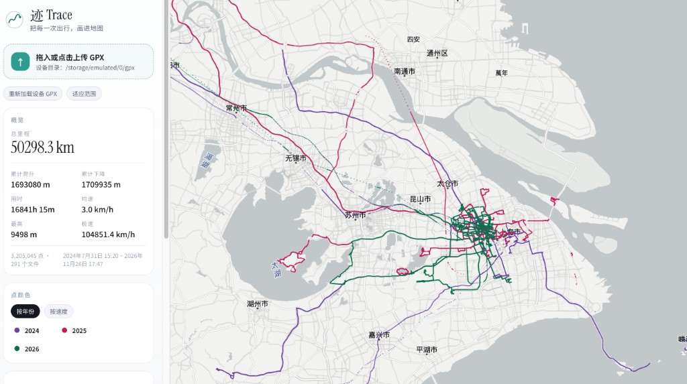

# 迹 Trace

GPX 轨迹点可视化：抽稀展示、时间范围筛选、多底图；可部署到安卓 Termux，电脑与手机浏览器都能打开。



## 功能

- 上传 / 自动加载设备 `/storage/emulated/0/gpx` 下全部 `.gpx`
- 按时间范围筛选展示轨迹点
- 按年份 / 步行·驾车·飞行分色，点大小可调
- 多种底图：高德官方样式（含卫星）/ OpenFreeMap；高德下自动做 GCJ 纠偏
- 里程、爬升、用时等统计
- 手机 Chrome：全屏地图 + 底部控件抽屉

## 开发

```bash
npm install
npm run dev
```

## 部署到手机 Termux

1. 手机打开 USB 调试，用数据线连 Mac，授权这台电脑  
2. 把 GPX 放到手机 `内部存储/gpx/`（即 `/storage/emulated/0/gpx`）  
3. 电脑执行：

```bash
npm run deploy:phone
```

4. 若服务未自动起来，在 Termux 执行一次安装+启动：

```bash
bash /sdcard/trace_gps/termux-start.sh
```

之后重启只需：

```bash
trace
```

（等价于 `trace restart`；还可用 `trace stop` / `trace status`）

每次 `npm run deploy:phone` 会同步 **运行包 + 源码**（`src/` 等，不含 `node_modules`）到：

- `/sdcard/trace_gps/`
- `~/trace_gps/`（`trace` / `termux-start.sh` 启动时再拷一份）

5. 打开网页：

| 端 | 地址 |
|---|---|
| 电脑（经 ADB 转发） | `http://127.0.0.1:4173` |
| **手机 Chrome（本机）** | `http://127.0.0.1:4173` |

手机与 Termux 在同一台设备上时，直接用本机回环地址即可；服务已监听 `0.0.0.0:4173`。

## 技术

- Vite + React + TypeScript + MapLibre
- `server.mjs` 静态托管 + GPX 目录 API
